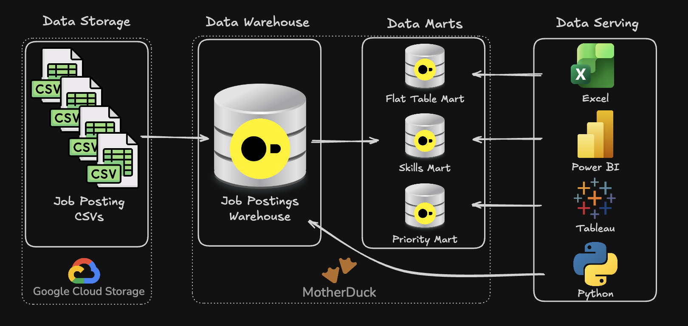

# Data Warehouse and Mart Build: Production ETL Pipeline

An end-to-end data engineering pipeline creating a normalised star schema data warehouse by transforming raw CSV files from Google Cloud Storage (GCS), this is then used to build analytical data marts.

## Executive Summary (For Hiring Managers)

- **Pipeline Scope**: A complete **ETL pipeline built** using raw CSV files --> star schema warehouse --> analytical marts.
- **Data Modeling**: **Designed a star schema** with fact tables, dimensions, and bridge tables for many-to-many relationships.
- **ETL Development**: **Extract, transform, load** processes implemented with data quality checks and idempotent operations.
- **Mart Architecture**: Created **specialised data marts** (flat, skills, priority) with additve measures and incremental update patterns.

## Problem and Context

Raw job posting data arrives as CSV files in GCS which does not have the structre for analytical queries. Analysts need to answer:

- Which skills are most in demand over time?
- What are the hiring trends by company and location?
- How do salary patterns vary by role and skill?

**Challenge:** Data teams need a data warehouse to act as a single source system, allowing for consistent and reliable analysis across the organisation. Additonally, to reduce query complexity and improve analytical pattern performance, specialised data marts are required to pre-aggregate data for specific use cases.

**Solution:** An End-to-end ETL pipeline. This extracts CSVs from cloud storage, normalising them into a star schema warehouse that seperates facts from dimensions. Specialised data marts are also created that is optimised for special use cases such as flat queries, skill demand analysis and priority role tracking.

## Tech Stack

- Database: DuckDB (file based OLAP database with GCS integration)
- Language: SQL (DDL for schema design, DML for data loading and transformation)
- Data Model: Star Schema (Fact, dimension and bridge tables)
- Development: VS Code for SQL editing and Terminal for DuckDB CLI execution
- Automation: Master SQL script for pipeline orchestration
- Version control: Git/GitHub for versioned pipeline scripts
- Storage: Google Cloud Storage for source CSV files

## Respository Structure

        2_WH_Mart_Build/
    ├── 01_create_tables_dw.sql        # Star schema DDL
    ├── 02_load_schema_dw.sql          # GCS data extraction & loading
    ├── 03_create_flat_mart.sql        # Denormalized flat mart
    ├── 04_create_skills_mart.sql      # Skills demand mart
    ├── 05_create_priority_mart.sql    # Priority roles mart
    ├── 06_update_priority_mart.sql    # Priority mart incremental update (MERGE)
    ├── 07_create_company_mart.sql     # Company hiring mart (optional)
    ├── build_dw_marts.sql             # Master SQL build script
    └── README.md                       # You are here

## Pipeline Architecture

The pipeline transforms job posting CSVs from GCS into a normalised star schema data warehouse; It then builds specialised data marts. BI tools such as Excel, Power BI and Python then consume from both the warehouse and the marts.

## Data Warehouse

The data warehouse implements a star schema with company_dim, skills_dim, skills_job_dim and job_postings_fact tables.

- **SQL Files:**
    - [01_create_tables_dw.sql](01_create_tables_dw.sql) – Defines star schema with 4 core tables
    - [02_load_schema_dw.sql](02_load_schema_dw.sql) – Extracts CSVs from GCS and loads into warehouse tables
- **Purpose:** Star schema serves as a single source of truth for analytical queries
- **Grain:** One row per job posting in the fact table (job_postings_fact)

## Flat Mart

Denormalised table with all dimensions for ad-hoc queries.

- **SQL File:** [03_create_flat_mart.sql](03_create_flat_mart.sql) – Builds denormalized table with all dimensions joined
- **Purpose:** Denormalised table for quick ad-hoc queries
- **Grain:** One row per job posting with all dimensions joined

## Skills Mart

Time-series skill demand analysis with additive measures.

- **SQL File:** [04_create_skills_mart.sql](04_create_skills_mart.sql) – Builds time-series skill demand mart
- **Purpose:** Time series analysis of skill demand over time with additive measures
- **Grain:** skill
-id + month_start_date + job_title_short
- **Key Features:** All measures are additive (counts/sums) for safe aggregation

## Priority Mart

Priority role tracking with incremental updates using MERGE operations.

- **SQL Files:**
    - [05_create_priority_mart.sql](05_create_priority_mart.sql) - Initial build of priority roles and jobs snapshot
    - [06_update_priority_mart.sql](06_update_priority_mart.sql) - Incremantal update using MERGE (upsert/pattern)
- **Purpose:** Track priority roles and job snapshots with incremental update capabilities
- **Grain:** One row per job posting with priority level assignment
- **Key features: MERGE operations for incremental updates** - Demonstrates production read upsert patterns (INSERT, UPDATE, DELETE in single statement)

## Data Engineering Skills Demonstrated

### ETL Pipeline Development

- **Extract:** Direct CSV loading from GCS using DuckDb's httpfs extension
- **Transform:** Data normalisation, type conversion (CAST, DATE_TRUNC) and quality filtering
- **Load:** Idempotent table creation with DROP TABLE IF EXISTS patterns
- **Incremental Updates:** MERGE operations for upsert patterns (INSERT, UPDATE, DELETE in single statement)
- **Orchestration:** Master SQL script (build_dw_marts.sql) for automated pipeline execution

### Dimension Modeling

- **Star Schema Desgin:** Fact table ('job_postings_fact') with dimension tables ('company_dim', 'skills_dim')
- **Bridge Tables:** Many-to-many relationship handling ('skills_job_dim', 'bridge_company_location', 'bridge_job_title')
- **Grain Definition:** Proper fact table granularity (skill + month, company + title + location + month)
- **Additive Measures:** Counts and sums that can safely be re-aggregated at any level

### SQL Advanced Techniques

- **DDL Operations:** 'CREATE TABLE', 'DROP TABLE', 'CREATE SCHEMA' for schema management
- **DML Operations:** 'INSERT INTO ...' 'SELECT' with explicit column mapping from CSV sources
- **Merge Operations:** Incremental updates using 'MERGE INTO' with 'WHEN MATCHED', 'WHEN NOT MATCHED', and 'WHEN NOT MATCHED' BY 'SOURCE' clauses for production-ready upsert patterns

- **CTEs:** Common Table Expressions for complex transformations and boolean flag conversions

- **Date Functions:** DATE_TRUNC('month'), EXTRACT(quarter) for temporal dimension creation

- **String Functions:** STRING_AGG for concatenation, REPLACE for data cleaning

- **Boolean Logic:** CASE WHEN conversions for aggregating flags (remote, health insurance, no degree)

### Data Quality and Production Practices

- **Idempotency:** All scripts safely rerunnable without side effects

- **Data Validation:** Verification queries at each pipeline step to ensure data integrity

- **Type Safety:** Proper data type definitions (VARCHAR, INTEGER, DOUBLE, BOOLEAN, TIMESTAMP)

- **Schema Organisation:** Separate schemas (flat_mart, skills_mart, priority_mart, company_mart) for logical separation

- **Error Handling:** Structured script execution with clear error messages and progress reporting